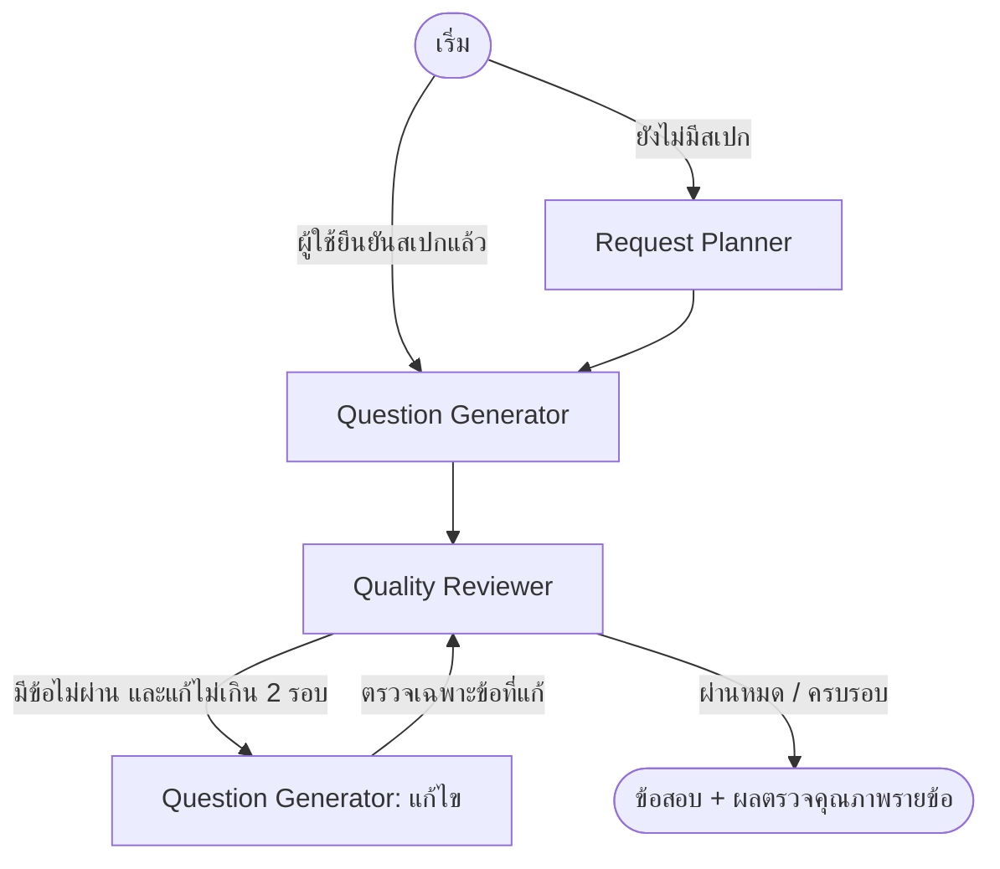

# Multi-Agent System for Automated Assessment Generation and Evaluative Essay Grading

ระบบสร้างข้อสอบ (ปรนัย + อัตนัย) พร้อมเฉลยจากสไลด์/เอกสาร/หัวข้อ ตามคำสั่งภาษาธรรมดา
แล้วตรวจคำตอบ ให้คะแนน และบอกว่าควรเรียนเพิ่มหรือปรับปรุงเรื่องไหน

> สถานะ: ฝั่ง**สร้างข้อสอบ**เป็น multi-agent บน LangGraph แล้ว (Planner → Generator ⇄ Reviewer)
> ฝั่ง**ตรวจคำตอบ**ยังเป็น pipeline เรียงลำดับ (กำลังทำคณะผู้ตรวจเรียงความ + Moderator)

## วิธีติดตั้งและรัน

```powershell
python -m venv .venv
.\.venv\Scripts\activate
pip install -r requirements.txt
copy .env.example .env
streamlit run app.py
```

เลือกโมเดลได้ 2 แบบด้วย `LLM_PROVIDER` ในไฟล์ `.env`

| ค่า | ใช้อะไร | ค่าใช้จ่าย | ต้องเตรียม |
|---|---|---|---|
| `ollama` (ค่าเริ่มต้น) | `gemma4:12b` รันในเครื่อง | ฟรี | ติดตั้ง [Ollama](https://ollama.com/download) แล้วรัน `ollama pull gemma4:12b` (~8GB, ควรมี GPU 8GB+) |
| `claude` | `claude-opus-5-5` ผ่าน API | ~$0.1–0.3 ต่อรอบ | ใส่ `ANTHROPIC_API_KEY` จาก https://console.anthropic.com |

ทดสอบ (ไม่ต้องใช้โมเดล): `python -m pytest`

## วิธีใช้

1. **สร้างข้อสอบ** — อัปโหลดสไลด์ (.pptx / .pdf / .txt) หรือใช้เนื้อหาตัวอย่าง หรือพิมพ์แค่หัวข้อ
   แล้วพิมพ์ว่าอยากได้ข้อสอบแบบไหน เช่น *"ปรนัย 5 ข้อ ถูก/ผิด 2 ข้อ อัตนัยตอบสั้น 1 ข้อ เรียงความ 1 ข้อ ระดับกลาง"*
   - กด **วิเคราะห์คำสั่ง** → ตรวจ/แก้สเปก (ชนิด จำนวนข้อ คะแนน ความยาก หัวข้อ) → กด **สร้างข้อสอบตามสเปกนี้**
   - ระหว่างสร้างจะเห็นว่า agent แต่ละตัวทำอะไร และหลังสร้างจะเห็นผลตรวจคุณภาพรายข้อ
2. **ทำข้อสอบ** — ตอบในแอป หรือ**อัปโหลดกระดาษคำตอบ** (PDF / รูปถ่าย) ทีละคน แล้วกดส่งตรวจ
   - รองรับทั้ง PDF ที่พิมพ์จากคอม และข้อสอบที่พิมพ์ออกไปเขียนด้วยมือแล้วสแกน/ถ่ายรูป
   - AI (โมเดลที่อ่านภาพได้) ถอดคำตอบแล้วเติมลงฟอร์มให้**ตรวจทานเทียบกับภาพก่อนส่งตรวจ**
     พร้อมป้ายเตือนข้อที่อ่านไม่ชัด หาไม่เจอ หรือตัวอักษรไม่ตรงกับข้อความตัวเลือก
3. **ผลและคำแนะนำ** — คะแนนรวม/แยกตอน, คะแนนรายหัวข้อ, เรื่องที่ต้องเรียนเพิ่ม + สไลด์ที่ควรทบทวน,
   และปุ่มสร้างแบบฝึกเพิ่มเฉพาะเรื่องที่อ่อน

### พิมพ์เป็น PDF
- แท็บ 1: **ข้อสอบ** (ไม่มีเฉลย มีช่องชื่อ/เลขที่/คะแนน และบรรทัดเขียนตอบ) และ **เฉลย + เกณฑ์ให้คะแนน** สำหรับผู้สอน
- แท็บ 3: **รายงานผลรายคน** (คะแนนรายหัวข้อ เรื่องที่ต้องเรียนเพิ่ม สไลด์ที่ควรทบทวน และรายละเอียดรายข้อ)

สร้าง PDF ด้วยเบราว์เซอร์ผ่าน Playwright (ใช้ Microsoft Edge หรือ Google Chrome ที่มีในเครื่อง
ถ้าไม่มีให้รัน `playwright install chromium`) เพื่อให้สระ วรรณยุกต์ และการตัดคำภาษาไทยถูกต้อง
ใช้ฟอนต์ [Sarabun](https://github.com/cadsondemak/Sarabun) (SIL Open Font License, อยู่ใน `assets/fonts/`)

## Agent ฝั่งสร้างข้อสอบ (LangGraph)



| Agent | หน้าที่ |
|---|---|
| **Request Planner** | แปลงคำสั่งภาษาธรรมดาเป็นสเปก (ชนิด จำนวน คะแนน ความยาก แนวข้อสอบ หัวข้อ) และบอกว่าใช้ค่า default ตรงไหน ผู้ใช้ตรวจ/แก้ได้ก่อนสร้าง |
| **Question Generator** | ออกข้อสอบ + เฉลย + rubric ตามสเปก โค้ดบังคับจำนวนข้อ/คะแนนให้ตรงสเปก (ได้ไม่ครบจะลองใหม่ 1 ครั้ง) และแก้ข้อที่ Reviewer ส่งกลับ |
| **Quality Reviewer** | ทำข้อปรนัยเอง**โดยไม่เห็นเฉลย** แล้วโค้ดเทียบกับเฉลย (ไม่ตรง = เฉลยอาจผิดหรือถูกได้หลายข้อ) และหาปัญหาร้ายแรง เช่น กำกวม ไม่ตรงเนื้อหา เกณฑ์ใช้ตรวจไม่ได้ |

สถานะรายข้อหลังจบกราฟ: ✅ ผ่าน · 🔧 แก้แล้วผ่าน · ⚠️ ยังมีปัญหา (แก้ครบรอบแล้วยังไม่ผ่าน ให้ผู้สอนตัดสิน) · ❔ ผู้ตรวจไม่ได้ตรวจ

ปุ่ม "สร้างแบบฝึกเพิ่มเรื่องที่อ่อน" ใช้กราฟเดียวกัน แต่ให้ Request Planner วางสเปกเองจากคำแนะนำของ Learning Advisor

## การทำงานของแต่ละส่วน

| ส่วน | ไฟล์ | ใช้ LLM? |
|---|---|---|
| อ่านเนื้อหา (PPTX รายสไลด์ + โน้ต, PDF, TXT, หัวข้อ) | `src/sources.py` | ไม่ |
| ลำดับการทำงานของ agent ฝั่งสร้างข้อสอบ (StateGraph + ลูปแก้) | `src/generation_graph.py` | – |
| แปลงคำสั่งเป็นสเปกข้อสอบ | `src/planner.py` | ใช่ (effort low) |
| ออกข้อสอบ + เฉลย + rubric + แท็กหัวข้อ/สไลด์ และแก้ข้อที่ไม่ผ่าน | `src/generator.py` | ใช่ (effort high) |
| ตรวจคุณภาพข้อสอบ (ทำข้อสอบเองโดยไม่เห็นเฉลย + หาปัญหา) | `src/reviewer.py` | ใช่ (effort high) |
| ตรวจปรนัย, รวมคะแนน, คะแนนรายหัวข้อ, ตรวจหลักฐาน | `src/scoring.py` | ไม่ |
| ตรวจอัตนัยตามเกณฑ์ พร้อมหลักฐานจากคำตอบ | `src/grader.py` | ใช่ (ทีละข้อ, ขนานกัน) |
| วิเคราะห์จุดอ่อนและคำแนะนำ | `src/advisor.py` | ใช่ |
| เรียกโมเดล (Ollama / Claude) + structured output + จัดการ error | `src/llm.py` | – |
| สร้าง PDF ข้อสอบ / เฉลย / รายงานผล | `src/export.py` | ไม่ |
| ถอดคำตอบจากกระดาษคำตอบ PDF / รูปถ่าย | `src/answer_reader.py` | ใช่ (อ่านภาพ) |

แนวคิดหลัก
- **ตัวเลขทุกตัวคำนวณด้วยโค้ด** (คะแนนปรนัย คะแนนรวม คะแนนรายหัวข้อ) LLM ใช้เฉพาะงานที่ต้องตีความ
- grader ต้องคัดลอก **หลักฐานจากคำตอบ** มาประกอบคะแนน โค้ดตรวจว่ามีอยู่จริง ถ้าไม่พบจะเตือนให้ผู้สอนตรวจซ้ำ
- คำตอบนักเรียนถูกห่อด้วย `<student_answer>` และสั่งให้ถือเป็นข้อมูล (กัน prompt injection)
- ทุก agent ได้ผลลัพธ์เป็น JSON ตาม Pydantic schema (Ollama: `format=<schema>`, Claude: structured output + server-side fallback)
- Ollama อ่าน PDF เองไม่ได้ ระบบจึงแยกข้อความจาก PDF ก่อน (เห็นเฉพาะข้อความ ไม่เห็นรูป/ตาราง)

## ขั้นต่อไป (roadmap)

1. ~~multi-agent ฝั่งสร้างข้อสอบบน LangGraph: Request Planner → Generator ⇄ Reviewer~~ ✅
2. ฝั่งตรวจบน LangGraph: ตรวจเรียงความด้วยคณะ grader 3 มุมมอง + Moderator
3. ประเมินระบบ: เทียบคะแนนกับมนุษย์ (QWK/MAE), grader เดี่ยว vs คณะ, ผลของ Reviewer, การชี้จุดอ่อน, prompt injection
