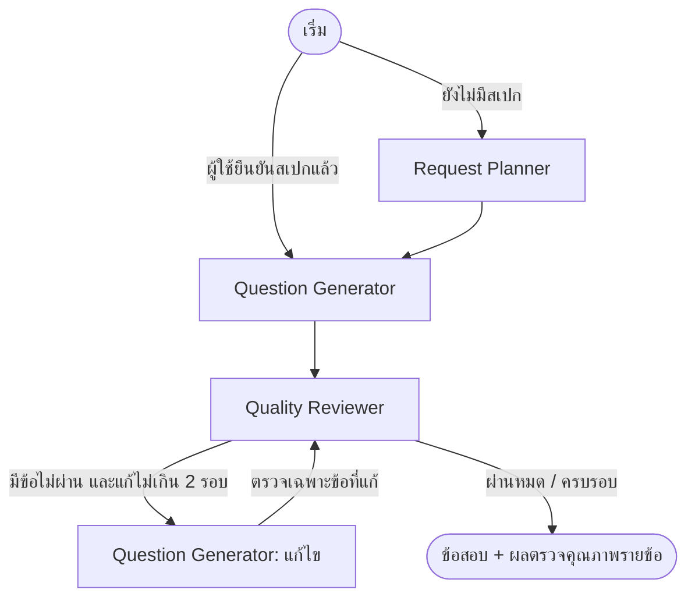

# Multi-Agent System for Automated Assessment Generation and Evaluative Essay Grading

ระบบสร้างข้อสอบ (ปรนัย + อัตนัย) พร้อมเฉลยจากสไลด์/เอกสาร/หัวข้อ ตามคำสั่งภาษาธรรมดา
แล้วตรวจคำตอบ ให้คะแนน และบอกว่าควรเรียนเพิ่มหรือปรับปรุงเรื่องไหน

> สถานะ: ฝั่ง**สร้างข้อสอบ**เป็น multi-agent บน LangGraph แล้ว (Planner → Generator ⇄ Reviewer)
> ฝั่ง**ตรวจคำตอบ**ยังเป็น pipeline เรียงลำดับ — ขั้นต่อไปดูที่ [roadmap](#ขั้นต่อไป-roadmap)

## วิธีติดตั้ง (Setup)

### สิ่งที่ต้องมี

| สิ่งที่ต้องมี | รายละเอียด |
|---|---|
| **Python 3.10 ขึ้นไป** | ทดสอบกับ 3.12 · Windows ดาวน์โหลดจาก [python.org](https://www.python.org/downloads/) และติ๊ก **Add python.exe to PATH** ตอนติดตั้ง |
| **Git** | สำหรับดาวน์โหลดโปรเจกต์ ([git-scm.com](https://git-scm.com/downloads)) หรือกด **Code → Download ZIP** บน GitHub แทนก็ได้ |
| **โมเดล AI** (เลือก 1 แบบ) | **Ollama** (ฟรี รันในเครื่อง): ควรมีการ์ดจอหน่วยความจำ 8 GB ขึ้นไป (ทดสอบกับ NVIDIA RTX 4070 12 GB) และพื้นที่ว่าง ~10 GB<br>หรือ **Claude API key** (เสียเงินตามการใช้งาน ไม่ต้องใช้การ์ดจอ) |
| **Microsoft Edge หรือ Google Chrome** | ใช้สร้างไฟล์ PDF · Windows มี Edge อยู่แล้ว |

> ทดสอบบน Windows 11 แล้ว · คำสั่งสำหรับ macOS / Linux ใส่ไว้ให้ แต่ยังไม่ได้ทดสอบจริง

### ขั้นที่ 1 — ดาวน์โหลดโปรเจกต์

```bash
git clone https://github.com/Bossomdn/ai-exam-generator-grader.git
cd ai-exam-generator-grader
```

### ขั้นที่ 2 — สร้าง virtual environment และติดตั้งแพ็กเกจ

**Windows (PowerShell)**
```powershell
python -m venv .venv
.\.venv\Scripts\Activate.ps1
python -m pip install --upgrade pip
pip install -r requirements.txt
```

> ถ้า PowerShell ขึ้นว่า *running scripts is disabled on this system* ให้รันคำสั่งนี้ครั้งเดียว แล้ว activate ใหม่
> `Set-ExecutionPolicy -Scope CurrentUser RemoteSigned`
> (หรือใช้ Command Prompt แทน: `.venv\Scripts\activate.bat`)

**macOS / Linux**
```bash
python3 -m venv .venv
source .venv/bin/activate
python -m pip install --upgrade pip
pip install -r requirements.txt
```

เมื่อ activate สำเร็จ บรรทัดคำสั่งจะขึ้นต้นด้วย `(.venv)` ทุกครั้งที่เปิด terminal ใหม่ต้อง activate ก่อนรันแอป

### ขั้นที่ 3 — สร้างไฟล์ตั้งค่า `.env`

```powershell
copy .env.example .env      # Windows
```
```bash
cp .env.example .env        # macOS / Linux
```

ไฟล์ `.env` อยู่ใน `.gitignore` จึงไม่ถูก push ขึ้น GitHub ใส่ API key ได้อย่างปลอดภัย

### ขั้นที่ 4 — เตรียมโมเดล (เลือก 1 แบบ)

**แบบ ก: Ollama — ฟรี รันในเครื่อง (ค่าเริ่มต้น)**

1. ดาวน์โหลดและติดตั้งจาก [ollama.com/download](https://ollama.com/download) ติดตั้งเสร็จ Ollama จะรันอยู่เบื้องหลังเอง
2. โหลดโมเดล (~8 GB ครั้งเดียว):
   ```bash
   ollama pull gemma4:12b
   ```
3. เช็กว่าโหลดแล้ว: `ollama list` ต้องเห็น `gemma4:12b`
4. ในไฟล์ `.env` ต้องเป็น `LLM_PROVIDER=ollama` (ตั้งไว้ให้แล้ว)

> - `gemma4:12b` อ่านภาพได้ จึงใช้ฟีเจอร์อัปโหลดกระดาษคำตอบ (PDF/รูปถ่าย) ได้
> - ถ้าการ์ดจอมีหน่วยความจำไม่พอ โมเดลจะรันบน CPU บางส่วนและช้ามาก
> - ครั้งแรกที่เรียกโมเดลหลังเปิดเครื่อง ต้องรอโหลดโมเดลเข้าการ์ดจอ ~1–2 นาที ครั้งถัดไปเร็วขึ้น

**แบบ ข: Claude API — เสียเงินตามการใช้งาน**

1. สร้าง API key ที่ [console.anthropic.com](https://console.anthropic.com) (ต้องเติมเครดิตก่อน)
2. แก้ไฟล์ `.env`:
   ```ini
   LLM_PROVIDER=claude
   ANTHROPIC_API_KEY=ใส่-key-ที่นี่
   ```
3. ค่าใช้จ่ายโดยประมาณ $0.1–0.5 ต่อรอบ (สร้างข้อสอบ + ตรวจ + คำแนะนำ) ขึ้นกับความยาวเนื้อหาและจำนวนข้อ

### ขั้นที่ 5 — เบราว์เซอร์สำหรับสร้าง PDF (เฉพาะเครื่องที่ไม่มี Edge/Chrome)

ระบบเรียกใช้ Edge หรือ Chrome ที่มีในเครื่องเอง ถ้าไม่มีทั้งสองตัว ให้ติดตั้ง Chromium ของ Playwright:

```bash
python -m playwright install chromium
# Linux ที่ขาด library ของระบบ: python -m playwright install --with-deps chromium
```

### ขั้นที่ 6 — ตรวจว่าติดตั้งครบ

```bash
python -m pytest
```

ทุกเทสต์ต้องผ่าน (ไม่ต้องใช้โมเดลหรืออินเทอร์เน็ต) ถ้าเครื่องไม่มีเบราว์เซอร์ เทสต์ที่สร้าง PDF จะขึ้นว่า *skipped*

### ขั้นที่ 7 — รันแอป

```bash
streamlit run app.py
```

เบราว์เซอร์จะเปิด http://localhost:8501 ให้เอง ดูที่แถบซ้าย (sidebar) ต้องขึ้น ✅ **Ollama พร้อมใช้งาน** หรือ ✅ **พบ Claude API key**

**ลองใช้ครั้งแรก:** แท็บ 1 → เลือก **ใช้เนื้อหาตัวอย่าง** → กด **วิเคราะห์คำสั่ง** → ดูสเปก → กด **สร้างข้อสอบตามสเปกนี้** (Ollama ใช้เวลา ~1 นาที)

**เปิดใช้ครั้งต่อไป:** เปิด terminal ในโฟลเดอร์โปรเจกต์ → activate venv (ขั้นที่ 2) → `streamlit run app.py` (ถ้าใช้ Ollama โปรแกรม Ollama ต้องเปิดอยู่)

### ค่าตั้งในไฟล์ `.env`

| ตัวแปร | ค่าเริ่มต้น | ความหมาย |
|---|---|---|
| `LLM_PROVIDER` | `ollama` | `ollama` (ในเครื่อง) หรือ `claude` (API) |
| `OLLAMA_MODEL` | `gemma4:12b` | โมเดลของ Ollama (ต้องอ่านภาพได้ ถ้าจะใช้อัปโหลดกระดาษคำตอบ) |
| `OLLAMA_HOST` | `http://localhost:11434` | ที่อยู่ของ Ollama |
| `OLLAMA_NUM_CTX` | `16384` | ความยาว context เพิ่มได้ถ้าเนื้อหายาวหรือข้อสอบหลายข้อ (ใช้หน่วยความจำการ์ดจอมากขึ้น) |
| `OLLAMA_THINK` | `false` | `true` = ให้โมเดลคิดก่อนตอบ แม่นขึ้นแต่ช้าลง และอาจเกิน context เมื่อมีรูป |
| `ANTHROPIC_API_KEY` | – | key ของ Claude API (ใช้เมื่อ `LLM_PROVIDER=claude`) |
| `CLAUDE_MODEL` | `claude-opus-5-5` | โมเดลของ Claude |

แก้ `.env` แล้วต้องหยุดแอป (Ctrl+C) และรัน `streamlit run app.py` ใหม่ เพราะค่าถูกอ่านตอนเริ่มแอปเท่านั้น

### แก้ปัญหาที่พบบ่อย

| อาการ / ข้อความที่เห็น | วิธีแก้ |
|---|---|
| "ยังไม่ได้เปิด Ollama" / "เชื่อมต่อ Ollama ไม่ได้" | เปิดโปรแกรม Ollama (หรือรัน `ollama serve`) แล้วรีเฟรชหน้าเว็บ |
| "ยังไม่ได้โหลดโมเดล" | รัน `ollama pull gemma4:12b` |
| "ผลลัพธ์ยาวเกินขีดจำกัด" | ลดจำนวนข้อ หรือเพิ่ม `OLLAMA_NUM_CTX` ใน `.env` (เช่น `32768`) แล้วรีสตาร์ตแอป |
| "โมเดลในเครื่องตอบกลับไม่ตรงรูปแบบ" | กดใหม่อีกครั้ง (โมเดลในเครื่องพลาดได้บางครั้ง) |
| "ยังไม่ได้ตั้ง ANTHROPIC_API_KEY" / "API key ไม่ถูกต้อง" | ตรวจ key ใน `.env` และ `LLM_PROVIDER=claude` แล้วรีสตาร์ตแอป |
| "ไม่พบเบราว์เซอร์สำหรับสร้าง PDF" | ติดตั้ง Edge หรือ Chrome หรือทำขั้นที่ 5 |
| `ModuleNotFoundError` | ยังไม่ได้ activate venv (ต้องเห็น `(.venv)`) หรือยังไม่ได้ `pip install -r requirements.txt` |
| `'streamlit' is not recognized` / `command not found` | activate venv ก่อน หรือใช้ `python -m streamlit run app.py` |
| พอร์ต 8501 ถูกใช้อยู่ | `streamlit run app.py --server.port 8502` |
| ครั้งแรกช้ามาก | ปกติ Ollama กำลังโหลดโมเดลเข้าการ์ดจอ (~1–2 นาที) |

### โครงสร้างโปรเจกต์

```
app.py             โครงหน้าเว็บ Streamlit (เรียกแต่ละแท็บจาก ui/)
ui/                หน้าจอแยกไฟล์ละแท็บ: create_tab (สร้างข้อสอบ) / take_tab (ทำข้อสอบ) / result_tab (ผลและคำแนะนำ) / sidebar
src/               agent และส่วนประกอบทั้งหมด (ดูตาราง "การทำงานของแต่ละส่วน")
tests/             เทสต์ pytest (ใช้ LLM จำลอง ไม่ต้องมีโมเดล) รวมเทสต์หน้าเว็บด้วย Streamlit AppTest
samples/           เนื้อหาตัวอย่าง: Machine Learning เบื้องต้น 7 สไลด์
assets/fonts/      ฟอนต์ Sarabun สำหรับ PDF ภาษาไทย
.github/           GitHub Actions (รันเทสต์อัตโนมัติ) และแบบฟอร์ม Pull Request
.env.example       ตัวอย่างค่าตั้ง (คัดลอกเป็น .env)
requirements.txt   รายการแพ็กเกจ Python
```

## ทำงานร่วมกันเป็นกลุ่ม

### กติกา
- **ห้าม push ตรงเข้า `main`** ทุกงานทำบน branch ของตัวเอง แล้วเปิด Pull Request (PR) ให้เพื่อนรีวิวอย่างน้อย 1 คนก่อน merge
- **`main` ต้องรันได้และเทสต์ผ่านเสมอ** GitHub Actions รัน `pytest` ให้อัตโนมัติทุก PR (ดูที่แท็บ Checks ของ PR) ถ้าขึ้นสีแดงต้องแก้ก่อน merge
- **PR เล็กและบ่อย** ดีกว่า PR ใหญ่ครั้งเดียว รีวิวง่ายและชนกันน้อย
- **ห้าม commit** ไฟล์ `.env`, API key หรือข้อมูลนักเรียนจริง (เก็บไว้ในโฟลเดอร์ `data/` ซึ่งอยู่ใน `.gitignore`)

### ขั้นตอนทำงาน 1 ชิ้น

```bash
# 1. เริ่มจาก main ล่าสุด แล้วแตก branch ใหม่
git checkout main
git pull
git checkout -b feature/grading-panel

# 2. เขียนโค้ด แล้ว commit เป็นระยะ
git add src/grading_graph.py tests/test_grading_graph.py
git commit -m "Add essay grader panel with moderator"

# 3. ระหว่างทำ ดึงงานล่าสุดของเพื่อนจาก main มารวมเป็นระยะ
git fetch origin
git merge origin/main

# 4. ก่อนเปิด PR รันเทสต์ในเครื่อง
python -m pytest

# 5. ส่ง branch ขึ้น GitHub
git push -u origin feature/grading-panel
```

6. เปิดหน้า repo บน GitHub กด **Compare & pull request** กรอกตามแบบฟอร์ม แล้วเลือกเพื่อนเป็น Reviewer
7. รีวิวผ่าน + Checks เป็นสีเขียว → กด **Squash and merge** แล้วลบ branch
8. กลับมาที่ main ในเครื่อง: `git checkout main && git pull`

### ตั้งชื่อ branch

| ขึ้นต้นด้วย | ใช้เมื่อ | ตัวอย่าง |
|---|---|---|
| `feature/` | เพิ่มความสามารถใหม่ | `feature/grading-panel` |
| `fix/` | แก้บั๊ก | `fix/pdf-thai-marks` |
| `eval/` | สคริปต์ประเมินผล / การทดลอง | `eval/essay-qwk` |
| `docs/` | เอกสาร รายงาน สไลด์ | `docs/report` |
| `chore/` | จัดระเบียบโค้ด ตั้งค่าโปรเจกต์ | `chore/team-setup` |

### แบ่งงานตาม roadmap

| branch | งาน | ต้องรอ |
|---|---|---|
| `feature/grading-panel` | คณะผู้ตรวจเรียงความ 3 คน + Moderator บน LangGraph | – |
| `feature/google-forms` | ส่งออก Google Form + นำเข้าผลตอบ CSV + ข้อมูลทั้งห้อง | – |
| `feature/item-analysis` | สถิติข้อสอบ + Item Analyst + ปรับปรุงข้อสอบจากผลจริง | google-forms |
| `feature/teacher-review` | คิวตรวจของครู + ปรับตามมาตรฐานครู | grading-panel |
| `eval/...` | สคริปต์ประเมินผลและเก็บข้อมูลจริง | grading-panel, item-analysis |
| `docs/report` | รายงาน / สไลด์ | – |

### ไฟล์ที่ต้องระวังชนกัน
- **หน้าเว็บ:** แยกไฟล์ละแท็บใน `ui/` แล้ว หน้าจอใหม่ (เช่น โหมดครู) ให้สร้างไฟล์ใหม่ใน `ui/` แล้วเพิ่มแค่ 2–3 บรรทัดใน `app.py`
- **`src/schemas.py`, `src/config.py`:** ทุกส่วนใช้ร่วมกัน ให้เพิ่มของใหม่ต่อท้ายไฟล์ และอย่าย้าย/เปลี่ยนชื่อของเดิมปนกับงานอื่นใน PR เดียวกัน
- **`requirements.txt`:** ถ้าเพิ่มแพ็กเกจ บอกในกลุ่มด้วย เพื่อนต้อง `pip install -r requirements.txt` ใหม่
- **เทสต์:** โมดูลใหม่ใน `src/` ควรมีเทสต์ใน `tests/` ที่ใช้ LLM จำลอง (ดูตัวอย่างใน `tests/test_generation_graph.py`) เพราะ GitHub Actions ไม่มีโมเดลจริง

### ถ้า merge แล้วเกิด conflict
Git จะใส่เครื่องหมาย `<<<<<<<`, `=======`, `>>>>>>>` ในไฟล์ที่ชนกัน
1. เปิดไฟล์นั้นใน VS Code แล้วกด **Accept Current / Incoming / Both** ตามที่ถูกต้อง (ถ้าไม่แน่ใจ ถามเจ้าของโค้ดส่วนนั้น)
2. บันทึกไฟล์ แล้วรัน `python -m pytest`
3. `git add <ไฟล์>` และ `git commit`

### สำหรับเจ้าของ repo (ตั้งครั้งเดียว)
1. **Settings → Collaborators → Add people** เพื่อเพิ่มเพื่อนในกลุ่ม
2. **Settings → Branches → Add rule** (หรือ **Rules → Rulesets**) สำหรับ `main`
   - เปิด **Require a pull request before merging** (Required approvals = 1)
   - เปิด **Require status checks to pass** แล้วเลือก `pytest (3.10)` และ `pytest (3.12)` (จะเลือกได้หลัง GitHub Actions รันครั้งแรกแล้ว)

## วิธีใช้

1. **สร้างข้อสอบ** — อัปโหลดสไลด์ (.pptx / .pdf / .txt) หรือใช้เนื้อหาตัวอย่าง หรือพิมพ์แค่หัวข้อ
   แล้วพิมพ์ว่าอยากได้ข้อสอบแบบไหน เช่น *"ปรนัย 5 ข้อ ถูก/ผิด 2 ข้อ อัตนัยตอบสั้น 1 ข้อ เรียงความ 1 ข้อ ระดับกลาง"*
   - กด **วิเคราะห์คำสั่ง** → ตรวจ/แก้สเปก (ชนิด จำนวนข้อ คะแนน ความยาก หัวข้อ) → กด **สร้างข้อสอบตามสเปกนี้**
   - ระหว่างสร้างจะเห็นว่า agent แต่ละตัวทำอะไร และหลังสร้างจะเห็นผลตรวจคุณภาพรายข้อ
2. **ทำข้อสอบ** — ตอบในแอป หรือ**อัปโหลดกระดาษคำตอบ** (PDF / รูปถ่าย) ทีละคน แล้วกดส่งตรวจ
   - รองรับทั้ง PDF ที่พิมพ์จากคอม และข้อสอบที่พิมพ์ออกไปเขียนด้วยมือแล้วสแกน/ถ่ายรูป
   - AI (โมเดลที่อ่านภาพได้) ถอดคำตอบแล้วเติมลงฟอร์มให้**ตรวจทานเทียบกับภาพก่อนส่งตรวจ**
     พร้อมป้ายเตือนข้อที่อ่านไม่ชัด หาไม่เจอ หรือตัวอักษรไม่ตรงกับข้อความตัวเลือก
3. **ผลและคำแนะนำ** — คะแนนรวม/แยกตอน, คะแนนรายหัวข้อ, เรื่องที่ต้องเรียนเพิ่ม + สไลด์ที่ควรทบทวน,
   และปุ่มสร้างแบบฝึกเพิ่มเฉพาะเรื่องที่อ่อน

### พิมพ์เป็น PDF
- แท็บ 1: **ข้อสอบ** (ไม่มีเฉลย มีช่องชื่อ/เลขที่/คะแนน และบรรทัดเขียนตอบ) และ **เฉลย + เกณฑ์ให้คะแนน** สำหรับผู้สอน
- แท็บ 3: **รายงานผลรายคน** (คะแนนรายหัวข้อ เรื่องที่ต้องเรียนเพิ่ม สไลด์ที่ควรทบทวน และรายละเอียดรายข้อ)

สร้าง PDF ด้วยเบราว์เซอร์ผ่าน Playwright (ใช้ Microsoft Edge หรือ Google Chrome ที่มีในเครื่อง
ถ้าไม่มีให้รัน `playwright install chromium`) เพื่อให้สระ วรรณยุกต์ และการตัดคำภาษาไทยถูกต้อง
ใช้ฟอนต์ [Sarabun](https://github.com/cadsondemak/Sarabun) (SIL Open Font License, อยู่ใน `assets/fonts/`)

## Agent ฝั่งสร้างข้อสอบ (LangGraph)



| Agent | หน้าที่ |
|---|---|
| **Request Planner** | แปลงคำสั่งภาษาธรรมดาเป็นสเปก (ชนิด จำนวน คะแนน ความยาก แนวข้อสอบ หัวข้อ) และบอกว่าใช้ค่า default ตรงไหน ผู้ใช้ตรวจ/แก้ได้ก่อนสร้าง |
| **Question Generator** | ออกข้อสอบ + เฉลย + rubric ตามสเปก โค้ดบังคับจำนวนข้อ/คะแนนให้ตรงสเปก (ได้ไม่ครบจะลองใหม่ 1 ครั้ง) และแก้ข้อที่ Reviewer ส่งกลับ |
| **Quality Reviewer** | ทำข้อปรนัยเอง**โดยไม่เห็นเฉลย** แล้วโค้ดเทียบกับเฉลย (ไม่ตรง = เฉลยอาจผิดหรือถูกได้หลายข้อ) และหาปัญหาร้ายแรง เช่น กำกวม ไม่ตรงเนื้อหา เกณฑ์ใช้ตรวจไม่ได้ |

สถานะรายข้อหลังจบกราฟ: ✅ ผ่าน · 🔧 แก้แล้วผ่าน · ⚠️ ยังมีปัญหา (แก้ครบรอบแล้วยังไม่ผ่าน ให้ผู้สอนตัดสิน) · ❔ ผู้ตรวจไม่ได้ตรวจ

ปุ่ม "สร้างแบบฝึกเพิ่มเรื่องที่อ่อน" ใช้กราฟเดียวกัน แต่ให้ Request Planner วางสเปกเองจากคำแนะนำของ Learning Advisor

## การทำงานของแต่ละส่วน

| ส่วน | ไฟล์ | ใช้ LLM? |
|---|---|---|
| หน้าเว็บ (แยกไฟล์ละแท็บ) | `app.py`, `ui/*.py` | – |
| อ่านเนื้อหา (PPTX รายสไลด์ + โน้ต, PDF, TXT, หัวข้อ) | `src/sources.py` | ไม่ |
| ลำดับการทำงานของ agent ฝั่งสร้างข้อสอบ (StateGraph + ลูปแก้) | `src/generation_graph.py` | – |
| แปลงคำสั่งเป็นสเปกข้อสอบ | `src/planner.py` | ใช่ (effort low) |
| ออกข้อสอบ + เฉลย + rubric + แท็กหัวข้อ/สไลด์ และแก้ข้อที่ไม่ผ่าน | `src/generator.py` | ใช่ (effort high) |
| ตรวจคุณภาพข้อสอบ (ทำข้อสอบเองโดยไม่เห็นเฉลย + หาปัญหา) | `src/reviewer.py` | ใช่ (effort high) |
| ตรวจปรนัย, รวมคะแนน, คะแนนรายหัวข้อ, ตรวจหลักฐาน | `src/scoring.py` | ไม่ |
| ตรวจอัตนัยตามเกณฑ์ พร้อมหลักฐานจากคำตอบ | `src/grader.py` | ใช่ (ทีละข้อ, ขนานกัน) |
| วิเคราะห์จุดอ่อนและคำแนะนำ | `src/advisor.py` | ใช่ |
| เรียกโมเดล (Ollama / Claude) + structured output + จัดการ error | `src/llm.py` | – |
| สร้าง PDF ข้อสอบ / เฉลย / รายงานผล | `src/export.py` | ไม่ |
| ถอดคำตอบจากกระดาษคำตอบ PDF / รูปถ่าย | `src/answer_reader.py` | ใช่ (อ่านภาพ) |

แนวคิดหลัก
- **ตัวเลขทุกตัวคำนวณด้วยโค้ด** (คะแนนปรนัย คะแนนรวม คะแนนรายหัวข้อ) LLM ใช้เฉพาะงานที่ต้องตีความ
- grader ต้องคัดลอก **หลักฐานจากคำตอบ** มาประกอบคะแนน โค้ดตรวจว่ามีอยู่จริง ถ้าไม่พบจะเตือนให้ผู้สอนตรวจซ้ำ
- คำตอบนักเรียนถูกห่อด้วย `<student_answer>` และสั่งให้ถือเป็นข้อมูล (กัน prompt injection)
- ทุก agent ได้ผลลัพธ์เป็น JSON ตาม Pydantic schema (Ollama: `format=<schema>`, Claude: structured output + server-side fallback)
- Ollama อ่าน PDF เองไม่ได้ ระบบจึงแยกข้อความจาก PDF ก่อน (เห็นเฉพาะข้อความ ไม่เห็นรูป/ตาราง)

## ขั้นต่อไป (roadmap)

เป้าหมาย: เป็น**ผู้ช่วยครูครบวงจร** ออกข้อสอบ → สอบจริงทั้งห้อง → ตรวจ → วิเคราะห์ข้อสอบจากผลจริง → ปรับปรุงข้อสอบ

1. ~~multi-agent ฝั่งสร้างข้อสอบบน LangGraph: Request Planner → Generator ⇄ Reviewer~~ ✅
2. ฝั่งตรวจบน LangGraph: คณะผู้ตรวจเรียงความ 3 มุมมอง + Moderator → ข้อที่เห็นต่างส่งให้ครูตัดสิน และให้ AI ปรับตามมาตรฐานของครู
3. วิเคราะห์ข้อสอบทั้งห้อง: ส่งออกเป็น Google Form → นำเข้าผลตอบ (CSV) → ค่าความยาก, อำนาจจำแนก, ตัวลวง, KR-20
   → Item Analyst บอกข้อที่ควรแก้/ตัด → ปรับปรุงข้อสอบจากผลจริง
4. ประเมินระบบ: Reviewer จับข้อบกพร่องได้แค่ไหน, คะแนนเรียงความเทียบครู (QWK/MAE), ผู้ตรวจเดี่ยว vs คณะ vs คณะ + มาตรฐานครู, การชี้จุดอ่อน, prompt injection
