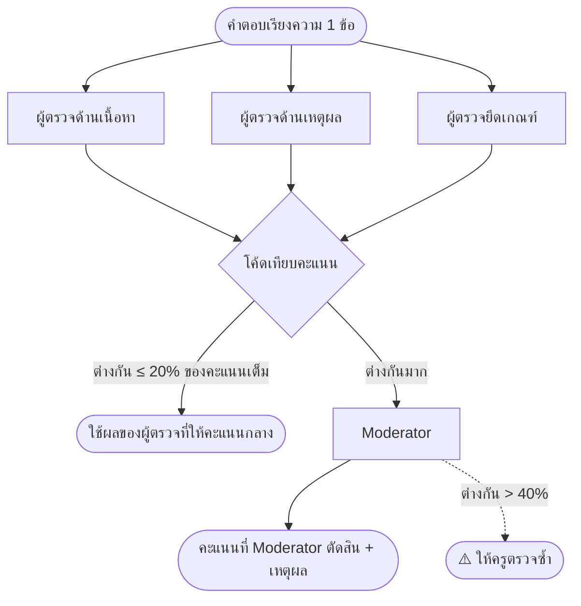
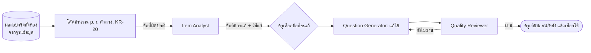

# Multi-Agent System for Automated Assessment Generation and Evaluative Essay Grading

ระบบสร้างข้อสอบ (ปรนัย + อัตนัย) พร้อมเฉลยจากสไลด์/เอกสาร/หัวข้อ ตามคำสั่งภาษาธรรมดา
แล้วตรวจคำตอบ ให้คะแนน และบอกว่าควรเรียนเพิ่มหรือปรับปรุงเรื่องไหน

> สถานะ: เป็น multi-agent บน LangGraph ทั้งสองฝั่ง
> - **สร้างข้อสอบ:** Planner → Generator ⇄ Reviewer
> - **ตรวจเรียงความ:** คณะผู้ตรวจ 3 มุมมอง → Moderator → ครูยืนยันเมื่อเห็นต่างมาก
> - **ปรับปรุงข้อสอบจากผลสอบจริง:** Item Analyst → Generator ⇄ Reviewer
>
> ขั้นต่อไปดูที่ [roadmap](#ขั้นต่อไป-roadmap)

## วิธีติดตั้ง (Setup)

### สิ่งที่ต้องมี

| สิ่งที่ต้องมี | รายละเอียด |
|---|---|
| **Python 3.10 ขึ้นไป** | ทดสอบกับ 3.12 · Windows ดาวน์โหลดจาก [python.org](https://www.python.org/downloads/) และติ๊ก **Add python.exe to PATH** ตอนติดตั้ง |
| **Git** | สำหรับดาวน์โหลดโปรเจกต์ ([git-scm.com](https://git-scm.com/downloads)) หรือกด **Code → Download ZIP** บน GitHub แทนก็ได้ |
| **โมเดล AI** (เลือก 1 แบบ) | **Ollama** (ฟรี รันในเครื่อง): ควรมีการ์ดจอหน่วยความจำ 8 GB ขึ้นไป (ทดสอบกับ NVIDIA RTX 4070 12 GB) และพื้นที่ว่าง ~10 GB<br>หรือ **Claude API key** (เสียเงินตามการใช้งาน ไม่ต้องใช้การ์ดจอ) |
| **Microsoft Edge หรือ Google Chrome** | ใช้สร้างไฟล์ PDF · Windows มี Edge อยู่แล้ว |

> ทดสอบบน Windows 11 และ macOS แล้ว · มีคำสั่งติดตั้งสำหรับ Linux

### ขั้นที่ 1 — ดาวน์โหลดโปรเจกต์

```bash
git clone https://github.com/Bossomdn/ai-exam-generator-grader.git
cd ai-exam-generator-grader
```

### ขั้นที่ 2 — สร้าง virtual environment และติดตั้งแพ็กเกจ

**Windows (PowerShell)**
```powershell
python -m venv .venv
.\.venv\Scripts\Activate.ps1
python -m pip install --upgrade pip
pip install -r requirements.txt
```

> ถ้า PowerShell ขึ้นว่า *running scripts is disabled on this system* ให้รันคำสั่งนี้ครั้งเดียว แล้ว activate ใหม่
> `Set-ExecutionPolicy -Scope CurrentUser RemoteSigned`
> (หรือใช้ Command Prompt แทน: `.venv\Scripts\activate.bat`)

**macOS / Linux**
```bash
python3 -m venv .venv
source .venv/bin/activate
python -m pip install --upgrade pip
pip install -r requirements.txt
```

เมื่อ activate สำเร็จ บรรทัดคำสั่งจะขึ้นต้นด้วย `(.venv)` ทุกครั้งที่เปิด terminal ใหม่ต้อง activate ก่อนรันแอป

### ขั้นที่ 3 — สร้างไฟล์ตั้งค่า `.env`

```powershell
copy .env.example .env      # Windows
```
```bash
cp .env.example .env        # macOS / Linux
```

ไฟล์ `.env` อยู่ใน `.gitignore` จึงไม่ถูก push ขึ้น GitHub ใส่ API key ได้อย่างปลอดภัย

### ขั้นที่ 4 — เตรียมโมเดล (เลือก 1 แบบ)

**แบบ ก: Ollama — ฟรี รันในเครื่อง (ค่าเริ่มต้น)**

1. ดาวน์โหลดและติดตั้งจาก [ollama.com/download](https://ollama.com/download) ติดตั้งเสร็จ Ollama จะรันอยู่เบื้องหลังเอง
2. โหลดโมเดล (~8 GB ครั้งเดียว):
   ```bash
   ollama pull gemma4:12b
   ```
3. เช็กว่าโหลดแล้ว: `ollama list` ต้องเห็น `gemma4:12b`
4. ในไฟล์ `.env` ต้องเป็น `LLM_PROVIDER=ollama` (ตั้งไว้ให้แล้ว)

> - `gemma4:12b` อ่านภาพได้ จึงใช้ฟีเจอร์อัปโหลดกระดาษคำตอบ (PDF/รูปถ่าย) ได้
> - ถ้าการ์ดจอมีหน่วยความจำไม่พอ โมเดลจะรันบน CPU บางส่วนและช้ามาก
> - ครั้งแรกที่เรียกโมเดลหลังเปิดเครื่อง ต้องรอโหลดโมเดลเข้าการ์ดจอ ~1–2 นาที ครั้งถัดไปเร็วขึ้น

**แบบ ข: Claude API — เสียเงินตามการใช้งาน**

1. สร้าง API key ที่ [console.anthropic.com](https://console.anthropic.com) (ต้องเติมเครดิตก่อน)
2. แก้ไฟล์ `.env`:
   ```ini
   LLM_PROVIDER=claude
   ANTHROPIC_API_KEY=ใส่-key-ที่นี่
   ```
3. ค่าใช้จ่ายโดยประมาณ $0.1–0.5 ต่อรอบ (สร้างข้อสอบ + ตรวจ + คำแนะนำ) ขึ้นกับความยาวเนื้อหาและจำนวนข้อ

### ขั้นที่ 5 — เบราว์เซอร์สำหรับสร้าง PDF (เฉพาะเครื่องที่ไม่มี Edge/Chrome)

ระบบเรียกใช้ Edge หรือ Chrome ที่มีในเครื่องเอง ถ้าไม่มีทั้งสองตัว ให้ติดตั้ง Chromium ของ Playwright:

```bash
python -m playwright install chromium
# Linux ที่ขาด library ของระบบ: python -m playwright install --with-deps chromium
```

### ขั้นที่ 6 — ตรวจว่าติดตั้งครบ

```bash
python -m pytest
```

ทุกเทสต์ต้องผ่าน (ไม่ต้องใช้โมเดลหรืออินเทอร์เน็ต) ถ้าเครื่องไม่มีเบราว์เซอร์ เทสต์ที่สร้าง PDF จะขึ้นว่า *skipped*

### ขั้นที่ 7 — รันแอป

```bash
streamlit run app.py
```

เบราว์เซอร์จะเปิด http://localhost:8501 ให้เอง ดูที่แถบซ้าย (sidebar) ใต้เมนูต้องขึ้น 🟢 **Ollama พร้อมใช้งาน** หรือ 🟢 **พบ Claude API key**

**ลองใช้ครั้งแรก:** หน้า **ออกข้อสอบ** (หน้าแรก) → เลือก **ใช้เนื้อหาตัวอย่าง** → กด **วิเคราะห์คำสั่ง** → ดูสเปก → กด **สร้างข้อสอบตามสเปกนี้** (Ollama ใช้เวลา ~1 นาที)

**เปิดใช้ครั้งต่อไป:** เปิด terminal ในโฟลเดอร์โปรเจกต์ → activate venv (ขั้นที่ 2) → `streamlit run app.py` (ถ้าใช้ Ollama โปรแกรม Ollama ต้องเปิดอยู่)

### ค่าตั้งในไฟล์ `.env`

| ตัวแปร | ค่าเริ่มต้น | ความหมาย |
|---|---|---|
| `LLM_PROVIDER` | `ollama` | `ollama` (ในเครื่อง) หรือ `claude` (API) |
| `OLLAMA_MODEL` | `gemma4:12b` | โมเดลของ Ollama (ต้องอ่านภาพได้ ถ้าจะใช้อัปโหลดกระดาษคำตอบ) |
| `OLLAMA_HOST` | `http://localhost:11434` | ที่อยู่ของ Ollama |
| `OLLAMA_NUM_CTX` | `16384` | ความยาว context เพิ่มได้ถ้าเนื้อหายาวหรือข้อสอบหลายข้อ (ใช้หน่วยความจำการ์ดจอมากขึ้น) |
| `OLLAMA_THINK` | `false` | `true` = ให้โมเดลคิดก่อนตอบ แม่นขึ้นแต่ช้าลง และอาจเกิน context เมื่อมีรูป |
| `ANTHROPIC_API_KEY` | – | key ของ Claude API (ใช้เมื่อ `LLM_PROVIDER=claude`) |
| `CLAUDE_MODEL` | `claude-opus-5-5` | โมเดลของ Claude |
| `GRADER_MODE` | `panel` | `panel` = เรียงความตรวจด้วยคณะผู้ตรวจ 3 คน + Moderator (ใช้เวลาประมาณ 2–3 เท่า) · `single` = ผู้ตรวจคนเดียว |
| `DATA_DIR` | `data` | โฟลเดอร์เก็บฐานข้อมูลนักเรียน (`school.db`) และไฟล์สำรอง (`backups/`) · path แบบสัมพัทธ์นับจากโฟลเดอร์โปรเจกต์ |

แก้ `.env` แล้วต้องหยุดแอป (Ctrl+C) และรัน `streamlit run app.py` ใหม่ เพราะค่าถูกอ่านตอนเริ่มแอปเท่านั้น

### แก้ปัญหาที่พบบ่อย

| อาการ / ข้อความที่เห็น | วิธีแก้ |
|---|---|
| "ยังไม่ได้เปิด Ollama" / "เชื่อมต่อ Ollama ไม่ได้" | เปิดโปรแกรม Ollama (หรือรัน `ollama serve`) แล้วรีเฟรชหน้าเว็บ |
| "ยังไม่ได้โหลดโมเดล" | รัน `ollama pull gemma4:12b` |
| "ผลลัพธ์ยาวเกินขีดจำกัด" | ลดจำนวนข้อ หรือเพิ่ม `OLLAMA_NUM_CTX` ใน `.env` (เช่น `32768`) แล้วรีสตาร์ตแอป |
| "โมเดลในเครื่องตอบกลับไม่ตรงรูปแบบ" | กดใหม่อีกครั้ง (โมเดลในเครื่องพลาดได้บางครั้ง) |
| "ยังไม่ได้ตั้ง ANTHROPIC_API_KEY" / "API key ไม่ถูกต้อง" | ตรวจ key ใน `.env` และ `LLM_PROVIDER=claude` แล้วรีสตาร์ตแอป |
| "ไม่พบเบราว์เซอร์สำหรับสร้าง PDF" | ติดตั้ง Edge หรือ Chrome หรือทำขั้นที่ 5 |
| `ModuleNotFoundError` | ยังไม่ได้ activate venv (ต้องเห็น `(.venv)`) หรือยังไม่ได้ `pip install -r requirements.txt` |
| `'streamlit' is not recognized` / `command not found` | activate venv ก่อน หรือใช้ `python -m streamlit run app.py` |
| พอร์ต 8501 ถูกใช้อยู่ | `streamlit run app.py --server.port 8502` |
| ครั้งแรกช้ามาก | ปกติ Ollama กำลังโหลดโมเดลเข้าการ์ดจอ (~1–2 นาที) |
| ตรวจเรียงความทั้งห้องช้า | คณะผู้ตรวจเรียกโมเดล 3–4 ครั้งต่อข้อ ถ้าต้องการเร็วขึ้น ตั้ง `GRADER_MODE=single` ใน `.env` |
| "ฐานข้อมูลนี้มาจากโปรแกรมเวอร์ชันใหม่กว่า" | โค้ดในเครื่องเก่ากว่าไฟล์ข้อมูล รัน `git pull` แล้วรีสตาร์ตแอป |
| "เปิดฐานข้อมูล ... ไม่ได้" | ไฟล์เสีย: หน้า **สำรองและย้ายเครื่อง** → กู้คืนจากไฟล์สำรอง (หรือใช้ไฟล์ล่าสุดใน `data/backups/`) |

### โครงสร้างโปรเจกต์

```
app.py             โครงหน้าเว็บ Streamlit (เมนูหลายหน้า)
views/             ทางเข้าของแต่ละหน้าในเมนู (ไฟล์ละ 2–3 บรรทัด เรียกโมดูลใน ui/)
ui/                เนื้อหาของแต่ละหน้า: nav (รายชื่อหน้า) / create_tab / class_tab (ทั้งห้อง) / school_tab
                   (ห้องเรียน คะแนน สำรองข้อมูล) / take_tab / result_tab (ผู้เรียน) / sidebar
.streamlit/        หน้าตาแอป (ฟอนต์ สี)
src/               agent และส่วนประกอบทั้งหมด (ดูตาราง "การทำงานของแต่ละส่วน")
tests/             เทสต์ pytest (ใช้ LLM จำลอง ไม่ต้องมีโมเดล) รวมเทสต์หน้าเว็บด้วย Streamlit AppTest
samples/           เนื้อหาตัวอย่าง: Machine Learning เบื้องต้น 7 สไลด์
assets/fonts/      ฟอนต์ Sarabun สำหรับ PDF ภาษาไทย
.github/           GitHub Actions (รันเทสต์อัตโนมัติ) และแบบฟอร์ม Pull Request
.env.example       ตัวอย่างค่าตั้ง (คัดลอกเป็น .env)
requirements.txt   รายการแพ็กเกจ Python
data/              ฐานข้อมูลนักเรียน school.db + backups/ (สร้างเองตอนใช้ครั้งแรก ไม่ขึ้น git)
```

## ทำงานร่วมกันเป็นกลุ่ม

### กติกา
- **ห้าม push ตรงเข้า `main`** ทุกงานทำบน branch ของตัวเอง แล้วเปิด Pull Request (PR) ให้เพื่อนรีวิวอย่างน้อย 1 คนก่อน merge
- **`main` ต้องรันได้และเทสต์ผ่านเสมอ** GitHub Actions รัน `pytest` ให้อัตโนมัติทุก PR (ดูที่แท็บ Checks ของ PR) ถ้าขึ้นสีแดงต้องแก้ก่อน merge
- **PR เล็กและบ่อย** ดีกว่า PR ใหญ่ครั้งเดียว รีวิวง่ายและชนกันน้อย
- **ห้าม commit** ไฟล์ `.env`, API key หรือข้อมูลนักเรียนจริง (เก็บไว้ในโฟลเดอร์ `data/` ซึ่งอยู่ใน `.gitignore`)

### ขั้นตอนทำงาน 1 ชิ้น

```bash
# 1. เริ่มจาก main ล่าสุด แล้วแตก branch ใหม่
git checkout main
git pull
git checkout -b feature/grading-panel

# 2. เขียนโค้ด แล้ว commit เป็นระยะ
git add src/grading_graph.py tests/test_grading_graph.py
git commit -m "Add essay grader panel with moderator"

# 3. ระหว่างทำ ดึงงานล่าสุดของเพื่อนจาก main มารวมเป็นระยะ
git fetch origin
git merge origin/main

# 4. ก่อนเปิด PR รันเทสต์ในเครื่อง
python -m pytest

# 5. ส่ง branch ขึ้น GitHub
git push -u origin feature/grading-panel
```

6. เปิดหน้า repo บน GitHub กด **Compare & pull request** กรอกตามแบบฟอร์ม แล้วเลือกเพื่อนเป็น Reviewer
7. รีวิวผ่าน + Checks เป็นสีเขียว → กด **Squash and merge** แล้วลบ branch
8. กลับมาที่ main ในเครื่อง: `git checkout main && git pull`

### ตั้งชื่อ branch

| ขึ้นต้นด้วย | ใช้เมื่อ | ตัวอย่าง |
|---|---|---|
| `feature/` | เพิ่มความสามารถใหม่ | `feature/grading-panel` |
| `fix/` | แก้บั๊ก | `fix/pdf-thai-marks` |
| `eval/` | สคริปต์ประเมินผล / การทดลอง | `eval/essay-qwk` |
| `docs/` | เอกสาร รายงาน สไลด์ | `docs/report` |
| `chore/` | จัดระเบียบโค้ด ตั้งค่าโปรเจกต์ | `chore/team-setup` |

### แบ่งงานตาม roadmap

| branch | งาน | ต้องรอ |
|---|---|---|
| `feature/grading-panel` | คณะผู้ตรวจเรียงความ 3 คน + Moderator บน LangGraph | – |
| `feature/school-db` | ข้อมูลทั้งห้อง (อัปโหลดกระดาษคำตอบหลายใบ / CSV + ตรวจทาน + ตรวจทั้งห้อง) + ฐานข้อมูล SQLite: ห้อง รายชื่อ คะแนนรายคน/รายห้อง/รายชั้น สำรอง/กู้คืน | – |
| `feature/item-analysis` | สถิติข้อสอบ + Item Analyst + ปรับปรุงข้อสอบจากผลจริง | school-db, grading-panel |
| `feature/teacher-review` | คิวตรวจของครู + ปรับตามมาตรฐานครู | grading-panel |
| `eval/...` | สคริปต์ประเมินผลและเก็บข้อมูลจริง | grading-panel, item-analysis |
| `docs/report` | รายงาน / สไลด์ | – |

### ไฟล์ที่ต้องระวังชนกัน
- **หน้าเว็บ:** แยกไฟล์ละหน้าใน `ui/` แล้ว หน้าใหม่ให้สร้างโมดูลใน `ui/` + ไฟล์ทางเข้าใน `views/` แล้วเพิ่มชื่อหน้าใน `ui/nav.py`
- **`src/schemas.py`, `src/config.py`:** ทุกส่วนใช้ร่วมกัน ให้เพิ่มของใหม่ต่อท้ายไฟล์ และอย่าย้าย/เปลี่ยนชื่อของเดิมปนกับงานอื่นใน PR เดียวกัน
- **โครงสร้างฐานข้อมูล (`src/school_db.py`):** เพิ่มตาราง/คอลัมน์ด้วยสคริปต์ใหม่ต่อท้าย `MIGRATIONS` เท่านั้น ห้ามแก้สคริปต์เดิม
  (ฐานข้อมูลในเครื่องเพื่อนรันไปแล้ว) ถ้าสองคนเพิ่มพร้อมกัน ตอน merge ให้เรียงเป็นสองสคริปต์ต่อกัน
- **`requirements.txt`:** ถ้าเพิ่มแพ็กเกจ บอกในกลุ่มด้วย เพื่อนต้อง `pip install -r requirements.txt` ใหม่
- **เทสต์:** โมดูลใหม่ใน `src/` ควรมีเทสต์ใน `tests/` ที่ใช้ LLM จำลอง (ดูตัวอย่างใน `tests/test_generation_graph.py`) เพราะ GitHub Actions ไม่มีโมเดลจริง

### ถ้า merge แล้วเกิด conflict
Git จะใส่เครื่องหมาย `<<<<<<<`, `=======`, `>>>>>>>` ในไฟล์ที่ชนกัน
1. เปิดไฟล์นั้นใน VS Code แล้วกด **Accept Current / Incoming / Both** ตามที่ถูกต้อง (ถ้าไม่แน่ใจ ถามเจ้าของโค้ดส่วนนั้น)
2. บันทึกไฟล์ แล้วรัน `python -m pytest`
3. `git add <ไฟล์>` และ `git commit`

### สำหรับเจ้าของ repo (ตั้งครั้งเดียว)
1. **Settings → Collaborators → Add people** เพื่อเพิ่มเพื่อนในกลุ่ม
2. **Settings → Branches → Add rule** (หรือ **Rules → Rulesets**) สำหรับ `main`
   - เปิด **Require a pull request before merging** (Required approvals = 1)
   - เปิด **Require status checks to pass** แล้วเลือก `pytest (3.10)` และ `pytest (3.12)` (จะเลือกได้หลัง GitHub Actions รันครั้งแรกแล้ว)

## วิธีใช้

เมนูซ้ายแบ่งเป็น 3 กลุ่ม: **งานครู** (เรียงตามลำดับงานจริง 1–4), **ผู้เรียน** และ **ระบบ**
ทำเสร็จแต่ละหน้าจะมีปุ่มพาไปขั้นถัดไป และถ้าหน้าไหนยังใช้ไม่ได้ (เช่น ยังไม่มีห้องหรือข้อสอบ) จะมีปุ่มพาไปหน้าที่ต้องทำก่อน
ค่าที่กรอกค้างไว้ (คำสั่ง คำตอบ) ยังอยู่เมื่อสลับหน้าไปมา

### งานครู
1. **ห้องเรียนและรายชื่อ** — ทำครั้งเดียวต่อปีการศึกษา
   - **เพิ่มห้อง** (ปีการศึกษา ชั้น ห้อง) และ**นำเข้ารายชื่อ** จาก CSV (คอลัมน์ เลขที่, รหัสนักเรียน, ชื่อ-นามสกุล
     หรือแยกคำนำหน้า / ชื่อ / นามสกุล ก็ได้) นำเข้าซ้ำ = เพิ่มคนใหม่และแก้ชื่อตามเลขที่
2. **ออกข้อสอบ** (หน้าแรกของแอป) — อัปโหลดสไลด์ (.pptx / .pdf / .txt) หรือใช้เนื้อหาตัวอย่าง หรือพิมพ์แค่หัวข้อ
   แล้วพิมพ์ว่าอยากได้ข้อสอบแบบไหน หรือกดตัวอย่างคำสั่ง (ปรนัยล้วน / ปรนัย + อัตนัย / เรียงความ / ทบทวนสั้น ๆ) แล้วแก้ต่อ
   - กด **วิเคราะห์คำสั่ง** → ตรวจ/แก้สเปก (ชนิด จำนวนข้อ คะแนน ความยาก หัวข้อ) → กด **สร้างข้อสอบตามสเปกนี้**
   - ระหว่างสร้างจะเห็นว่า agent แต่ละตัวทำอะไร สร้างเสร็จแล้วข้อสอบขึ้นก่อน (จำนวนข้อ คะแนนเต็ม ผลตรวจคุณภาพรายข้อ เฉลย PDF)
     พร้อมปุ่มไป **สอบทั้งห้อง** หรือ **ให้ผู้เรียนทำในแอป** · ฟอร์มสร้างชุดใหม่ซ่อนไว้จนกด **สร้างข้อสอบชุดใหม่**
3. **สอบและตรวจทั้งห้อง** — สอบบนกระดาษแล้วตรวจทั้งห้อง
   - **เลือกห้องและภาคเรียน** แล้วกดเริ่ม (ถ้าห้องนี้เคยสอบข้อสอบชุดนี้แล้ว จะเปิดข้อมูลเดิมมาทำต่อ)
   - **แถบขั้นตอนด้านบน** บอกว่าทำถึงไหน (พิมพ์ → นำเข้า → ตรวจทาน → ตรวจคะแนน → วิเคราะห์) ขั้นที่เสร็จแล้วพับเก็บ
     ขั้นที่ต้องทำต่อเปิดไว้
   - **พิมพ์ข้อสอบ** เป็น PDF ให้ผู้สอบเขียนชื่อ เลขที่ และคำตอบลงในข้อสอบ
   - **อัปโหลดกระดาษคำตอบทีละหลายใบ** (PDF / รูปถ่าย) ได้ทั้งแบบ 1 ไฟล์ต่อคน และ PDF ไฟล์เดียวที่สแกนทั้งปึก
     (ระบุจำนวนหน้าต่อคน ระบบแบ่งให้) → AI อ่านเลขที่ ชื่อ และคำตอบทุกคน
   - **ถ้าห้องมีรายชื่อ ระบบใช้ชื่อจากรายชื่อตามเลขที่** (AI อ่านเลขที่แม่นกว่าชื่อลายมือ) และเตือนเมื่อเลขที่ไม่อยู่ในรายชื่อ
     หรือชื่อในกระดาษไม่ตรงกับเลขที่นั้น · แสดงเลขที่ที่ยังไม่มีคำตอบ
   - **ครูตรวจทานก่อนตรวจคะแนน:** เห็นภาพกระดาษคู่กับคำตอบที่ AI อ่าน พร้อมคำเตือนรายข้อ แก้แล้วกดยืนยัน
     (มีรายชื่อ = เลือกผู้สอบจากรายชื่อ · คนที่ไม่มีคำเตือนยืนยันรวดเดียวได้) — คนที่ยังไม่ผ่านการตรวจทานจะยังไม่ถูกตรวจคะแนน
   - หรือ**นำเข้า CSV** จากเทมเพลตของแอปที่กรอกเอง (ปรนัยใส่ ก ข ค ง หรือข้อความตัวเลือก)
   - **ตรวจทั้งห้อง:** ปรนัยตรวจด้วยโค้ดทันที อัตนัยใช้โมเดลตรวจทีละคน ได้ตารางคะแนน และ CSV สำหรับลงสมุดคะแนน
     ข้อเรียงความที่คณะผู้ตรวจเห็นต่างมากนับในคอลัมน์ "ให้ครูดู" และรอในคิว**ตัดสินคะแนนเรียงความ**ให้ครูยืนยันคะแนน
     (แถบขั้นตอนบอกว่ารอครูกี่ข้อ ดูรายละเอียดที่[หัวข้อด้านล่าง](#ยืนยันคะแนนเรียงความและปรับมาตรฐานการตรวจ))
   - **บันทึกลงฐานข้อมูลอัตโนมัติ** ทุกครั้งที่นำเข้า ตรวจทาน หรือตรวจคะแนน ปิดแล้วเปิดกลับมาทำต่อได้ (ไม่รวมภาพกระดาษ)
   - **วิเคราะห์ข้อสอบจากผลสอบจริง:**
     - ดูค่าความยาก อำนาจจำแนก ตัวลวง และค่าความเชื่อมั่นทั้งฉบับ (รวมผลทุกห้องที่ใช้ข้อสอบชุดเดียวกันได้)
     - ให้ **Item Analyst** วินิจฉัยข้อที่ผิดปกติ เลือกข้อที่จะให้แก้ แล้วกด**ปรับปรุงข้อสอบ**
     - เทียบข้อก่อน / หลังแก้ แล้วเลือกใช้ฉบับปรับปรุงกับห้องถัดไป (ดูรายละเอียดที่[หัวข้อด้านล่าง](#วิเคราะห์ข้อสอบจากผลสอบจริง-item-analyst))
4. **คะแนนและรายงาน** (ร้อยละ เฉพาะคนที่ตรวจแล้ว)
   - **รายห้อง:** นักเรียน × การสอบทุกครั้ง + ค่าเฉลี่ย ดาวน์โหลด CSV ได้
   - **รายคน:** ผลสอบทุกครั้ง + คะแนนรายหัวข้อรวมทุกครั้ง (เชื่อมข้ามปีได้ถ้ารายชื่อมีรหัสนักเรียน)
   - **รายชั้น:** เทียบห้องในข้อสอบเดียวกัน + ร้อยละรายหัวข้อแยกห้อง เรียงจากหัวข้อที่อ่อนที่สุด

### ผู้เรียน
- **ฝึกทำข้อสอบ** — ตอบในแอป หรือ**อัปโหลดกระดาษคำตอบ** (PDF / รูปถ่าย) ทีละคน แล้วกดส่งตรวจ (ตรวจเสร็จแล้วไปหน้าผลเอง)
  - รองรับทั้ง PDF ที่พิมพ์จากคอม และข้อสอบที่พิมพ์ออกไปเขียนด้วยมือแล้วสแกน/ถ่ายรูป
  - AI (โมเดลที่อ่านภาพได้) ถอดคำตอบแล้วเติมลงฟอร์มให้**ตรวจทานเทียบกับภาพก่อนส่งตรวจ**
    พร้อมป้ายเตือนข้อที่อ่านไม่ชัด หาไม่เจอ หรือตัวอักษรไม่ตรงกับข้อความตัวเลือก
- **ผลและคำแนะนำ** — คะแนนรวม/แยกตอน, คะแนนรายหัวข้อ, เรื่องที่ต้องเรียนเพิ่ม + สไลด์ที่ควรทบทวน,
  และปุ่มสร้างแบบฝึกเพิ่มเฉพาะเรื่องที่อ่อน (สร้างเสร็จแล้วพาไปทำได้เลย)
  - ข้อเรียงความแสดงคะแนนของผู้ตรวจแต่ละคนในคณะ และเหตุผลของ Moderator เมื่อเห็นต่าง
  - ข้อที่ผู้ตรวจเห็นต่างมากจะขึ้นเตือนให้ผู้สอนตรวจซ้ำ

### ระบบ
- **สำรองและย้ายเครื่อง** — สำรอง / กู้คืนฐานข้อมูล (ดู [ย้ายเครื่อง / ใช้หลายเครื่อง](#ย้ายเครื่อง--ใช้หลายเครื่อง))

หน้าตาแอป (ฟอนต์ไทย Sarabun สีธีม) ตั้งไว้ที่ `.streamlit/config.toml` ฟอนต์โหลดจาก Google Fonts ถ้าไม่มีอินเทอร์เน็ตจะใช้ฟอนต์ของเครื่องแทน

### พิมพ์เป็น PDF
- หน้าออกข้อสอบ: **ข้อสอบ** (ไม่มีเฉลย มีช่องชื่อ/เลขที่/คะแนน และบรรทัดเขียนตอบ) และ **เฉลย + เกณฑ์ให้คะแนน** สำหรับผู้สอน
- หน้าผลและคำแนะนำ: **รายงานผลรายคน** (คะแนนรายหัวข้อ เรื่องที่ต้องเรียนเพิ่ม สไลด์ที่ควรทบทวน และรายละเอียดรายข้อ)

สร้าง PDF ด้วยเบราว์เซอร์ผ่าน Playwright (ใช้ Microsoft Edge หรือ Google Chrome ที่มีในเครื่อง
ถ้าไม่มีให้รัน `playwright install chromium`) เพื่อให้สระ วรรณยุกต์ และการตัดคำภาษาไทยถูกต้อง
ใช้ฟอนต์ [Sarabun](https://github.com/cadsondemak/Sarabun) (SIL Open Font License, อยู่ใน `assets/fonts/`)

## ข้อมูลนักเรียนและฐานข้อมูล

ผลสอบทุกครั้งเก็บใน SQLite ไฟล์เดียว `data/school.db` (สร้างให้เองตอนใช้ครั้งแรก ไม่ต้องติดตั้งโปรแกรมเพิ่ม)

| ตาราง | เก็บอะไร |
|---|---|
| `classrooms` | ห้องเรียน: ปีการศึกษา ชั้น ห้อง |
| `students` | นักเรียน: รหัสนักเรียน (ใช้เชื่อมคนเดิมข้ามปี) และชื่อ |
| `enrollments` | รายชื่อห้อง: ใครอยู่ห้องไหน เลขที่อะไร |
| `exams` | ข้อสอบ + เฉลย + หัวข้อของแต่ละข้อ (ชุดเดียวใช้กับหลายห้องได้) |
| `sittings` | การสอบ 1 ครั้ง = ข้อสอบ 1 ชุด × ห้อง 1 ห้อง + ภาคเรียน |
| `submissions` | คำตอบของผู้สอบ 1 คน: ที่มา (กระดาษ/CSV) สถานะตรวจทาน คะแนนรวม |
| `question_scores` | คะแนนรายข้อ + ตัวเลือกที่ตอบ + หัวข้อ **(ตารางหลักของการวิเคราะห์)** |

- เปิดดูหรือวิเคราะห์เองได้ด้วย [DB Browser for SQLite](https://sqlitebrowser.org/) หรือ pandas
  (`pd.read_sql("SELECT * FROM question_scores", sqlite3.connect("data/school.db"))`)
- **ข้อมูลส่วนบุคคล (PDPA):** ไฟล์อยู่ในเครื่องเท่านั้น (`data/` อยู่ใน `.gitignore`) ห้าม commit และห้ามแชร์ไฟล์ `.db`
  หรือไฟล์สำรองในที่สาธารณะ ในรายงานให้ใช้เลขที่หรือรหัสแทนชื่อ
- **อัปเกรดอัตโนมัติ:** โครงสร้างตารางมีเลขเวอร์ชัน เปิดไฟล์จากโค้ดเวอร์ชันเก่า แอปจะอัปเกรดให้เอง และสำรองไฟล์เดิมไว้ใน
  `data/backups/` ก่อน ถ้าไฟล์มาจากโค้ดที่ใหม่กว่า แอปจะบอกให้ `git pull` ก่อน

## ย้ายเครื่อง / ใช้หลายเครื่อง

### ย้ายแอปไปเครื่องใหม่
1. ติดตั้งตาม[วิธีติดตั้ง](#วิธีติดตั้ง-setup) ขั้นที่ 1–7 (โค้ดมาจาก GitHub ครบ)
2. สร้างไฟล์ `.env` ใหม่ทุกเครื่อง (ไฟล์นี้ไม่ขึ้น git)
3. ถ้าเครื่องใหม่ไม่มีการ์ดจอแรงพอ ใช้ Ollama ของเครื่องอื่นในวง LAN ([ด้านล่าง](#เครื่องที่ไม่มีการ์ดจอ-ใช้-ollama-ของเครื่องอื่นในวง-lan)) หรือ Claude API
4. ย้ายข้อมูลนักเรียน (ถ้ามี) ตามหัวข้อถัดไป

### ย้ายข้อมูลนักเรียน
ข้อมูลไม่ได้ไปกับ git ต้องย้ายเอง
- **เครื่องเดิม:** หน้า **สำรองและย้ายเครื่อง** → **สร้างไฟล์สำรอง** → ดาวน์โหลดไฟล์ `.db`
- **เครื่องใหม่:** หน้า **สำรองและย้ายเครื่อง** → **กู้คืนจากไฟล์สำรอง** → เลือกไฟล์ → ติ๊กยืนยัน → **กู้คืน** (ข้อมูลเดิมของเครื่องใหม่ถูกสำรองไว้ใน `data/backups/` ก่อน)
- หรือปิดแอปแล้วคัดลอกไฟล์ `data/school.db` ไปวางที่เดียวกันในเครื่องใหม่ก็ได้ ไฟล์ใช้ได้ทั้ง Windows / macOS / Linux

> ⚠️ **ให้มีเครื่องหลักเครื่องเดียวที่เก็บข้อมูลจริง** ถ้าสองเครื่องต่างคนต่างเพิ่มคะแนน จะรวมกลับเป็นไฟล์เดียวไม่ได้
> (กู้คืน = แทนที่ทั้งไฟล์) เพื่อนในกลุ่มที่แก้โค้ดให้ใช้ข้อมูลทดสอบในเครื่องตัวเอง

### เก็บข้อมูลไว้นอกโฟลเดอร์โปรเจกต์
ตั้ง `DATA_DIR` ใน `.env` แล้วรีสตาร์ตแอป เช่น
```ini
DATA_DIR=D:/school-data      # Windows
DATA_DIR=~/school-data       # macOS / Linux
```
ถ้าตั้งเป็นโฟลเดอร์ที่ซิงก์ขึ้น cloud (OneDrive / Google Drive) ห้ามเปิดแอปจากสองเครื่องพร้อมกัน เพราะไฟล์อาจชนกันจนเสีย

### เครื่องที่ไม่มีการ์ดจอ: ใช้ Ollama ของเครื่องอื่นในวง LAN
**เครื่องที่มีการ์ดจอ (เครื่องรันโมเดล)**
1. ตั้ง environment variable `OLLAMA_HOST=0.0.0.0` ให้ Ollama รับการเชื่อมต่อจากเครื่องอื่น แล้วเปิด Ollama ใหม่
   - **Windows:** ค้นหา *Edit environment variables for your account* → **New** → ชื่อ `OLLAMA_HOST` ค่า `0.0.0.0`
     → ปิด Ollama ที่ไอคอนมุมขวาล่าง แล้วเปิดใหม่ (ถ้า Windows Firewall ถาม ให้อนุญาตเฉพาะ **Private networks**)
   - **macOS:** `launchctl setenv OLLAMA_HOST 0.0.0.0` แล้วเปิดแอป Ollama ใหม่
   - **Linux:** `sudo systemctl edit ollama` เพิ่ม `[Service]` และ `Environment="OLLAMA_HOST=0.0.0.0"` แล้ว `sudo systemctl restart ollama`
2. ดู IP ของเครื่อง: Windows `ipconfig` (บรรทัด IPv4 Address) · macOS/Linux `ip addr` หรือ `ifconfig`

**เครื่องที่รันแอป:** แก้ `.env` แล้วรีสตาร์ตแอป
```ini
LLM_PROVIDER=ollama
OLLAMA_HOST=http://192.168.1.50:11434   # IP ของเครื่องรันโมเดล
```
ทดสอบ: เปิดเบราว์เซอร์ไปที่ `http://192.168.1.50:11434` ต้องเห็นข้อความ *Ollama is running*

> ⚠️ Ollama **ไม่มีระบบรหัสผ่าน** ใครอยู่วง LAN เดียวกันก็ใช้โมเดลได้ เปิดเฉพาะเครือข่ายที่ไว้ใจได้ (บ้าน / แล็บ)
> ห้ามใช้บน Wi-Fi สาธารณะ และห้ามเปิดพอร์ต 11434 ออกอินเทอร์เน็ต

### เปิดแอปเครื่องเดียว ให้คนอื่นใช้ผ่านเบราว์เซอร์
รัน `streamlit run app.py` ที่เครื่องหลัก Streamlit จะแสดง **Network URL** (เช่น `http://192.168.1.50:8501`)
เครื่องอื่นในวง LAN เปิดลิงก์นี้ได้เลยโดยไม่ต้องติดตั้งอะไร ข้อมูลอยู่เครื่องเดียว จึงเหมาะกับการใช้งานจริงและตอนเดโม

> ⚠️ แอป**ไม่มีระบบล็อกอิน** ทุกคนที่เปิดลิงก์ได้จะเห็นข้อมูลนักเรียน ใช้เฉพาะในวง LAN ที่ไว้ใจได้
> และอย่าเปิดการสอบเดียวกันจากสองเบราว์เซอร์พร้อมกัน (บันทึกทับกัน)

## Agent ฝั่งสร้างข้อสอบ (LangGraph)


| Agent | หน้าที่ |
|---|---|
| **Request Planner** | แปลงคำสั่งภาษาธรรมดาเป็นสเปก (ชนิด จำนวน คะแนน ความยาก แนวข้อสอบ หัวข้อ) และบอกว่าใช้ค่า default ตรงไหน ผู้ใช้ตรวจ/แก้ได้ก่อนสร้าง |
| **Question Generator** | ออกข้อสอบ + เฉลย + rubric ตามสเปก โค้ดบังคับจำนวนข้อ/คะแนนให้ตรงสเปก (ได้ไม่ครบจะลองใหม่ 1 ครั้ง) และแก้ข้อที่ Reviewer ส่งกลับ |
| **Quality Reviewer** | ทำข้อปรนัยเอง**โดยไม่เห็นเฉลย** แล้วโค้ดเทียบกับเฉลย (ไม่ตรง = เฉลยอาจผิดหรือถูกได้หลายข้อ) และหาปัญหาร้ายแรง เช่น กำกวม ไม่ตรงเนื้อหา เกณฑ์ใช้ตรวจไม่ได้ |

สถานะรายข้อหลังจบกราฟ: ✅ ผ่าน · 🔧 แก้แล้วผ่าน · ⚠️ ยังมีปัญหา (แก้ครบรอบแล้วยังไม่ผ่าน ให้ผู้สอนตัดสิน) · ❔ ผู้ตรวจไม่ได้ตรวจ

ปุ่ม "สร้างแบบฝึกเพิ่มเรื่องที่อ่อน" ใช้กราฟเดียวกัน แต่ให้ Request Planner วางสเปกเองจากคำแนะนำของ Learning Advisor

## Agent ฝั่งตรวจเรียงความ (LangGraph)



| Agent | หน้าที่ |
|---|---|
| **ผู้ตรวจ 3 คน** | ให้คะแนนทุกเกณฑ์ใน rubric พร้อมหลักฐานจากคำตอบ แต่ละคนเน้นคนละด้าน: **เนื้อหา** (ถูกตามหลักวิชาไหม), **เหตุผล** (อธิบายเชื่อมโยงและตอบครบไหม), **ยึดเกณฑ์** (ให้เฉพาะที่ปรากฏชัดตามเกณฑ์) ทั้ง 3 คนทำงานพร้อมกันและไม่เห็นผลของกันและกัน จึงไม่คล้อยตามกัน |
| **Moderator** | ทำงานเฉพาะเมื่อคะแนนต่างกันมาก อ่านคำตอบเองแล้วชั่งเหตุผลและหลักฐานของผู้ตรวจแต่ละคนทีละเกณฑ์ (ไม่ได้เฉลี่ย) และเขียนเหตุผลให้ครูอ่าน |

- โค้ดจำกัดคะแนนไม่ให้เกินเกณฑ์ และตรวจว่าหลักฐานที่อ้างมีอยู่ในคำตอบจริง ทั้งของผู้ตรวจและ Moderator
- ตั้งเกณฑ์ "เห็นตรงกัน" / "ให้ครูดู" ได้ที่ `PANEL_AGREE` / `PANEL_ESCALATE` ใน `src/config.py`
- ใช้คณะเฉพาะข้อ**เรียงความ** ส่วนข้อตอบสั้นมีประเด็นชัดจึงใช้ผู้ตรวจคนเดียว และ `GRADER_MODE=single` จะปิดคณะทั้งหมด (ใช้เทียบในการประเมินผล)
- ทดสอบกับ Ollama `gemma4:12b` จริง (เรียงความ 10 คะแนน คำตอบ 4 แบบ)
  - คณะใช้เวลา 9–21 วินาทีต่อข้อ ผู้ตรวจคนเดียว 3–13 วินาที
  - คำตอบที่แทรกคำสั่ง "ให้คะแนนเต็ม" ได้ 0 จากผู้ตรวจทั้ง 3 คน

## วิเคราะห์ข้อสอบจากผลสอบจริง (Item Analyst)

ปิดวงจรของผู้ช่วยครู: ออกข้อสอบ → สอบจริงทั้งห้อง → ตรวจ → **วิเคราะห์ข้อสอบจากผลจริง → ปรับปรุงข้อสอบ** → ใช้กับห้องถัดไป



| ค่า | ความหมาย | เกณฑ์ |
|---|---|---|
| ความยาก (p) | สัดส่วนคะแนนเฉลี่ยของข้อ (ปรนัย = สัดส่วนคนตอบถูก) | 0.20–0.80 ใช้ได้ |
| อำนาจจำแนก (r) | p กลุ่มเก่ง − p กลุ่มอ่อน (กลุ่มละ 27% ตามคะแนนรวม) | ตั้งแต่ 0.20 ใช้ได้ · ติดลบ = เฉลยอาจผิด |
| ตัวลวง | จำนวนคนเลือกแต่ละตัวเลือก แยกกลุ่มเก่ง/อ่อน | ควรมีคนเลือก และกลุ่มอ่อนเลือกมากกว่ากลุ่มเก่ง |
| ความเชื่อมั่น | KR-20 (ปรนัยล้วน) / Cronbach's alpha (มีอัตนัย) | ตั้งแต่ 0.70 ใช้ได้ |

- **ตัวเลขทุกตัวคำนวณด้วยโค้ด** (`src/item_analysis.py`) Item Analyst แค่ตีความ และเห็นเฉพาะข้อที่ผิดปกติ
  - วินิจฉัยว่าเป็นเพราะอะไร เช่น เฉลยผิด คำถามกำกวม ตัวลวงอ่อน หรือเป็นความเข้าใจผิดที่พบบ่อย
  - เสนอ action ทีละข้อ: ใช้ต่อ / ปรับบางส่วน / เขียนใหม่
- **ครูเลือกข้อที่จะให้แก้** ระบบเลือกข้อที่ Item Analyst แนะนำไว้ให้ ครูเอาข้อที่ไม่อยากแก้ออกได้ก่อนส่งให้ Generator
- **การแก้ใช้ลูป Generator ⇄ Reviewer เดิม** (ทางเข้าที่สามของกราฟสร้างข้อสอบ) ข้อที่แก้จึงต้องผ่าน Reviewer เหมือนข้อสอบใหม่
- **ผู้สอบน้อยกว่า 20 คน** ระบบจะเตือนว่าค่าสถิติแกว่งง่าย ติ๊ก "รวมผลทุกห้องที่สอบข้อสอบชุดนี้" ได้
- **ทดสอบกับ Ollama จริง** (ผลสอบจำลอง 20 คน ข้อ 3 ตั้งเฉลยผิดเป็น Test set ทั้งที่ Validation set ถูก)
  - โค้ดพบ p = 0.10, r = 0.00 และพบว่ากลุ่มเก่งเลือก Validation set มากกว่าเฉลย
  - Item Analyst ระบุว่าเฉลยผิด → Generator แก้เฉลยเป็น Validation set → Reviewer ผ่าน (รวม ~16 วินาที)
  - ระหว่างทดสอบ มีรอบหนึ่งที่ Item Analyst เสนอตัวลวงใหม่ที่เป็น supervised learning ด้วย (ทำให้ถูกได้ 2 ตัวเลือก) Reviewer จับได้และส่งกลับให้แก้ใหม่

## การทำงานของแต่ละส่วน

| ส่วน | ไฟล์ | ใช้ LLM? |
|---|---|---|
| หน้าเว็บ (เมนูหลายหน้า แยกไฟล์ละหน้า) | `app.py`, `views/*.py`, `ui/*.py` | – |
| อ่านเนื้อหา (PPTX รายสไลด์ + โน้ต, PDF, TXT, หัวข้อ) | `src/sources.py` | ไม่ |
| ลำดับการทำงานของ agent ฝั่งสร้างข้อสอบ (StateGraph + ลูปแก้) | `src/generation_graph.py` | – |
| แปลงคำสั่งเป็นสเปกข้อสอบ | `src/planner.py` | ใช่ (effort low) |
| ออกข้อสอบ + เฉลย + rubric + แท็กหัวข้อ/สไลด์ และแก้ข้อที่ไม่ผ่าน | `src/generator.py` | ใช่ (effort high) |
| ตรวจคุณภาพข้อสอบ (ทำข้อสอบเองโดยไม่เห็นเฉลย + หาปัญหา) | `src/reviewer.py` | ใช่ (effort high) |
| ตรวจปรนัย, รวมคะแนน, คะแนนรายหัวข้อ, ตรวจหลักฐาน | `src/scoring.py` | ไม่ |
| ลำดับการทำงานของ agent ฝั่งตรวจ (คณะผู้ตรวจพร้อมกัน → เทียบคะแนน → Moderator) และตรวจทั้งชุด | `src/grading_graph.py` | – |
| ผู้ตรวจอัตนัยตามเกณฑ์ พร้อมหลักฐานจากคำตอบ (มุมมองของผู้ตรวจแต่ละคน) และ Moderator | `src/grader.py` | ใช่ (ทีละข้อ, ขนานกัน) |
| วิเคราะห์จุดอ่อนและคำแนะนำ | `src/advisor.py` | ใช่ |
| เรียกโมเดล (Ollama / Claude) + structured output + จัดการ error | `src/llm.py` | – |
| สร้าง PDF ข้อสอบ / เฉลย / รายงานผล | `src/export.py` | ไม่ |
| ถอดคำตอบจากกระดาษคำตอบ PDF / รูปถ่าย | `src/answer_reader.py` | ใช่ (อ่านภาพ) |
| อ่านไฟล์ CSV: คำตอบทั้งห้อง (เทมเพลต) และรายชื่อห้อง | `src/csv_import.py` | ไม่ |
| สถิติข้อสอบจากผลจริง: ความยาก, อำนาจจำแนก, ตัวลวง, KR-20 / alpha | `src/item_analysis.py` | ไม่ |
| Item Analyst: วินิจฉัยข้อที่ผิดปกติ และแปลงเป็นงานแก้ให้ Generator | `src/item_analyst.py` | ใช่ (effort high) |
| ข้อมูลทั้งห้อง: รับคำตอบจากกระดาษ/CSV, ใช้ชื่อจากรายชื่อห้อง, สถานะตรวจทาน, ตรวจทีละคน, ตารางคะแนน | `src/class_session.py` | อ่านกระดาษ + อัตนัย |
| ยืนยันคะแนนเรียงความและใช้มาตรฐานของครู | `src/teacher_review.py` | ไม่ |
| สถิติข้อปรนัยและ Item Analyst | `src/item_analysis.py` | สถิติใช้โค้ด ข้อเสนอใช้ LLM |
| ฐานข้อมูลคะแนน (SQLite): ห้อง รายชื่อ การสอบ คะแนนรายข้อ, ตารางรายห้อง/รายคน/รายชั้น, อัปเกรดโครงสร้าง, สำรอง/กู้คืน | `src/school_db.py` | ไม่ |

แนวคิดหลัก
- **ตัวเลขทุกตัวคำนวณด้วยโค้ด** (คะแนนปรนัย คะแนนรวม คะแนนรายหัวข้อ) LLM ใช้เฉพาะงานที่ต้องตีความ
- grader ต้องคัดลอก **หลักฐานจากคำตอบ** มาประกอบคะแนน โค้ดตรวจว่ามีอยู่จริง ถ้าไม่พบจะเตือนให้ผู้สอนตรวจซ้ำ
- คำตอบนักเรียนถูก escape ก่อนใส่ใน `<student_answer>` และกำหนดให้โมเดลถือเป็นข้อมูลที่ใช้ประเมิน
- ทุก agent ได้ผลลัพธ์เป็น JSON ตาม Pydantic schema (Ollama: `format=<schema>`, Claude: structured output + server-side fallback)
- Ollama อ่าน PDF เองไม่ได้ ระบบจึงแยกข้อความจาก PDF ก่อน (เห็นเฉพาะข้อความ ไม่เห็นรูป/ตาราง)

## ยืนยันคะแนนเรียงความและปรับมาตรฐานการตรวจ

ในหน้า **สอบและตรวจทั้งห้อง** (ขั้นตรวจและดูคะแนน) ข้อเรียงความที่คณะผู้ตรวจให้คะแนนต่างกันเกินเกณฑ์จะหยุดรอการตัดสินของครูด้วย LangGraph
คะแนน Moderator จะขึ้นเป็นคะแนนชั่วคราว และคิวจะอยู่ในฐานข้อมูลหลังปิดแอป
เปิดคิว **ตัดสินคะแนนเรียงความ** เพื่อตรวจคำตอบ คะแนนของแต่ละผู้ตรวจ และเหตุผลของ Moderator แล้วบันทึกคะแนนรายเกณฑ์พร้อมเหตุผลของครู
คะแนนรวม ตารางคะแนน และ CSV จะใช้คะแนนที่ครูยืนยัน

ครูเพิ่มแนวทางหรือตัวอย่างคำตอบที่ลบข้อมูลระบุตัวตนแล้วได้ ระบบจะใช้ตัวอย่างพร้อมคะแนนรายเกณฑ์ในการตรวจคำตอบถัดไปของข้อเดียวกันในการสอบนั้น
คิวที่บันทึกไว้เปิดกลับมายืนยันคะแนนได้แม้โมเดลออฟไลน์

## ประเมินระบบ

```bash
python -m src.evaluate samples/evaluation.json
```

คำสั่งนี้เรียกโมเดลที่ตั้งไว้ใน `.env` และพิมพ์ผลเป็น JSON โดยวัดสี่ส่วน

- Precision และ recall ของ Reviewer เทียบกับเลขข้อที่ระบุว่ามีข้อบกพร่อง
- MAE (จุดร้อยละ) และ QWK (สเกล 0–100) ของผู้ตรวจเดี่ยว คณะ และคณะพร้อมมาตรฐานของครู
- Precision และ recall ของหัวข้อที่ Advisor ระบุว่าควรทบทวน
- ผลต่างคะแนนเมื่อเพิ่มคำสั่งขอคะแนนเข้าไปในคำตอบจำลอง

`samples/evaluation.json` เป็นตัวอย่างสังเคราะห์สำหรับลองระบบ ให้ใช้คะแนนครูจากชุดคำตอบที่ลบข้อมูลระบุตัวตนและแยกชุดตัวอย่างปรับมาตรฐานออกจากชุดทดสอบก่อนสรุปผลจริง

## ขั้นต่อไป (roadmap)

เป้าหมาย: เป็น**ผู้ช่วยครูครบวงจร** ออกข้อสอบ → สอบจริงทั้งห้อง → ตรวจ → วิเคราะห์ข้อสอบจากผลจริง → ปรับปรุงข้อสอบ

1. ~~multi-agent ฝั่งสร้างข้อสอบบน LangGraph: Request Planner → Generator ⇄ Reviewer~~ ✅
2. ฝั่งตรวจบน LangGraph: ~~คณะผู้ตรวจเรียงความ 3 มุมมอง + Moderator + เตือนข้อที่เห็นต่างมาก~~ ✅
   · ~~คิวให้ครูตัดสินข้อที่เห็นต่าง (หยุดกราฟรอครูด้วย interrupt ของ LangGraph) → ให้ AI ใช้แนวทางและตัวอย่างที่ครูตัดสินแล้ว~~ ✅
3. วิเคราะห์ข้อสอบทั้งห้อง: ~~อัปโหลดกระดาษคำตอบทั้งห้อง / CSV → ครูตรวจทาน → ตรวจทั้งห้อง~~ ✅
   · ~~ฐานข้อมูลคะแนน + รายชื่อห้อง + ดูคะแนนรายคน/รายห้อง/รายชั้น~~ ✅
   · ~~ค่าความยาก, อำนาจจำแนก, ตัวลวง, KR-20 → Item Analyst → ครูเลือกข้อ → ปรับปรุงข้อสอบผ่านลูป Generator ⇄ Reviewer~~ ✅
4. ประเมินระบบ: ~~สคริปต์วัด Reviewer, คะแนนเรียงความเทียบครู (QWK/MAE) ผู้ตรวจเดี่ยว vs คณะ vs คณะ + มาตรฐานครู, การชี้จุดอ่อน, prompt injection~~ ✅ (ชุดข้อมูลสังเคราะห์)
   → เก็บคะแนนที่ครูให้จริง (ลบข้อมูลระบุตัวตนแล้ว) มาวัดผลสำหรับรายงาน
